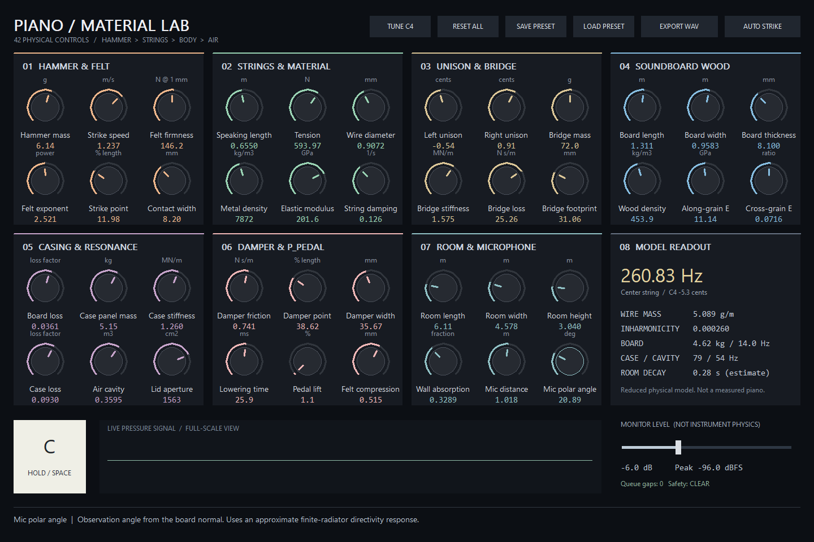

# Piano Material Lab

A native Windows C piano workbench with **42 physical controls**, a playable key,
live waveform, exact parameter entry, presets, and WAV export. All sound is
generated from scratch; there are no piano recordings or MIDI dependencies.



## Run or build

Download `piano.exe` from [Releases](../../releases), put it in a writable folder,
and open it. No compiler, Python, API key, or SDL is needed to play.

To build from source on 64-bit Windows:

```bat
build.bat
piano.exe
```

The first build downloads portable Zig 0.13.0 from ziglang.org, verifies its
pinned SHA-256, and uses its Clang C compiler. It does not install anything
system-wide. Close the running executable before rebuilding it.

## Play and adjust

- Hold the white key, **Space**, or **C** to play.
- Drag knobs vertically; **Shift** makes fine adjustments. Mouse wheel works too.
- Double-click a knob to type a value; **Enter** applies and **Escape** cancels.
- Right-click restores one knob. **Reset All** restores the reference instrument.
- **Tune C4** solves string tension for the current material and dimensions.
- **Auto Strike** repeats the note while you adjust controls. **S** toggles sustain.
- Save/load a preset, or export the current instrument to `test-note.wav`.

The groups cover hammer/felt, strings/material, unison/bridge, soundboard wood,
casing/resonance, damper/pedal, and room/microphone. Settings save when the app
closes; personal presets and generated audio are excluded from Git.

## Physical model

The engine uses three stiff strings with 32 modes each, a nonlinear hammer
contact, a bridge model, 64 orthotropic-plate modes, casing and cavity resonances,
damper contact, and room reflections. Parameters change model quantities such as
mass, force, tension, dimensions, material stiffness, loss, and absorption.

This is a **reduced physical model**, not a calibrated piano or full 3D simulation.
See [the model and limitations](MODEL.txt), [all 42 controls](CONTROL-GUIDE.txt),
and [the original validation record](WORKBENCH-VALIDATION.txt).

## Tests

With Python 3 and NumPy installed:

```powershell
python -m pip install numpy
.\piano.exe --test
python verify-sound.py
.\piano.exe --sweep
python tools/verify-sweep.py
.\compiler\zig-windows-x86_64-0.13.0\zig.exe cc -O2 engine-validation.c -o engine-validation.exe
.\engine-validation.exe
```

For native interaction and actual audio-device checks, run
`powershell -ExecutionPolicy Bypass -File check-workbench.ps1` on an interactive
Windows desktop. It uses a separate test copy and preserves the main app's settings.
GitHub Actions runs the renderer and numerical checks; it does not verify speakers.

## Optional audio-model review

`listen.py` sends a generated WAV to an audio-capable OpenAI model and saves its
text assessment. This is optional and uses an API key and API billing. Run
`setup-audio-key.cmd` to store a key locally using Windows account encryption;
never commit a key. See [the detailed instructions](README.txt).

The audio model's judgments are separate from numerical tests and are not
guaranteed to match a human listener's assessment.
